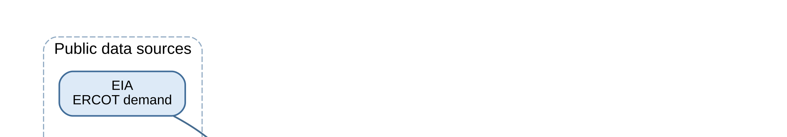
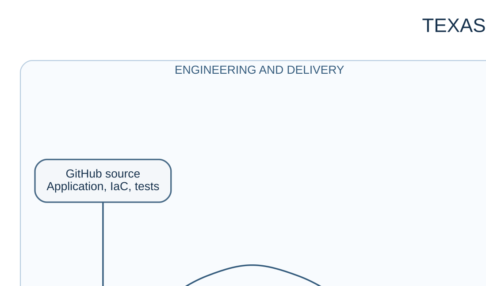

# Texas Energy Intelligence

A production-style portfolio for short-term ERCOT electricity-demand forecasting. It demonstrates a real batch data and MLOps architecture: EIA demand and five-city Open-Meteo weather, immutable data contracts, Spark and Delta Lake transformations, three independent forecast paths, evidence-based evaluation, a static dashboard, and a private read-only AI analyst.

## Live dashboard

[Open the live Texas Energy Intelligence dashboard](https://d2na4w34xrcyyi.cloudfront.net/)





## What is included

- Lambda ingestion, EventBridge scheduling, S3 Bronze, Glue/Spark Silver and Gold, and Step Functions orchestration source.
- SageMaker Processing adapters for XGBoost, Bi-LSTM, and pretrained zero-shot Chronos-2.
- Immutable forecast lineage, prospective evaluation, approval-gated model selection, and test contracts.
- Private AgentCore runtime code with bounded read-only evidence tools and optional local MCP/RAG components.
- Sanitized Terraform implementation under [`infra/terraform`](infra/terraform) and non-executable GitHub Actions implementation under [`ci-cd/github-actions`](ci-cd/github-actions). They are teaching artifacts, not deployment instructions for an AWS account.

## Important boundaries

This export is an engineering portfolio snapshot. It intentionally excludes cloud credentials, state, account identifiers, production outputs, real forecast data, internal history, and operational workflows. The dashboard source is included without its generated data payloads. Public CI is offline-only and has no AWS credentials or OIDC permissions. The Terraform implementation preserves HCL syntax but uses explicit example account values and must be parameterized for any independent deployment.

Predictions are experimental and are not intended for grid dispatch, electricity trading, or safety-critical decisions. Forecast values are estimates, source availability can lag, and missing observations remain pending rather than being inferred or treated as zero. Candidate models may improve through documented experiments, but production promotion requires explicit human approval.

## Quick start

```bash
python -m venv .venv
# Windows: .venv\Scripts\activate
# macOS/Linux: source .venv/bin/activate
python -m pip install --upgrade pip
python -m pip install -e ".[test]"
python -m pytest -q tests/test_package.py tests/test_glue_entrypoint.py tests/test_glue_packaging.py tests/test_model_lifecycle.py tests/forecast/test_curve_contract.py tests/forecast/test_curve_comparison.py tests/forecast/test_evaluation.py tests/forecast/test_dashboard_evaluation.py tests/forecast/test_point_in_time.py tests/forecast/test_issued_curve_evaluation.py tests/ingestion/test_bronze.py tests/ingestion/test_eia.py tests/ingestion/test_open_meteo.py
```

The command above is the exact Python 3.11 offline suite in `.github/workflows/ci.yml`; Spark/Delta runtime tests and cloud integrations are deliberately excluded from this public snapshot. The private publisher is eligible once per America/Chicago calendar day in its 9:17 PM after-hours window, and publishes only a changed, validated snapshot. See the editable diagram sources in [docs/architecture](docs/architecture) and the architecture notes in [docs/PROJECT_STRUCTURE.md](docs/PROJECT_STRUCTURE.md).
